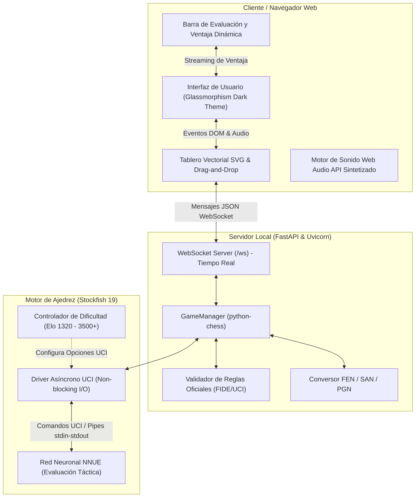

<div align="center">

# ♟️ Stockfish Arena

### Interfaz Gráfica Web Moderna y Suite Interactiva para Stockfish 19

[](https://www.python.org/)
[](https://fastapi.tiangolo.com/)
[](https://websockets.readthedocs.io/)
[](https://stockfishchess.org/)
[](#instalación-y-ejecución)
[](COPYING.txt)

<p align="center">
  <b>Una experiencia de ajedrez fluida, moderna y reactiva impulsada por el motor de ajedrez más fuerte del mundo.</b>
  <br />
  Ajuste dinámico de fuerza desde principiante (Elo 1320) hasta nivel sobrehumano (+3500 Elo NNUE), barra de evaluación en vivo, síntesis de audio procedimental y ejecución con un solo clic.
</p>

</div>

---

## 🌟 Características Principales

- 🤖 **Integración Profunda con Stockfish 19 NNUE**: Comunicación asíncrona mediante el protocolo UCI con subproceso no bloqueante y control dinámico de hilos y memoria hash.
- 🎯 **Dificultad Dinámica y Control Preciso de Elo**:
  - **6 Presets Calibrados**: Desde nivel *Principiante* (Elo 1320) hasta *Máxima Potencia* (+3500 Elo con evaluación de red neuronal NNUE completa).
  - **Slider de Ajuste Fino Continuo**: Permite fijar cualquier valor exacto de Elo entre 1320 y 3190 con aplicación en tiempo real.
- 📊 **Barra de Evaluación y Ventaja en Tiempo Real**: Visualización gráfica del balance posicional en centipeones (o jugadas para mate) y cálculo de curva de probabilidad de victoria (*Win Chance*).
- ♟️ **Tablero Vectorial SVG de Alta Definición**: Piezas vectoriales nítidas en cualquier resolución con soporte para *drag-and-drop* suave y clics interactivos.
- 🔊 **Audio Procedimental Nativo (Web Audio API)**: Efectos de sonido realistas para movimientos, capturas, jaques y finales generados por síntesis de osciladores, sin depender de archivos de audio externos ni descargas de red.
- 📜 **Historial Oficial y Conteo de Material**: Registro en notación algebraica estándar (SAN), seguimiento visual de piezas capturadas y balance de material en vivo.
- 🔄 **Selector de Bando y Volteo**: Juega con blancas o negras con orientación automática del tablero.
- 🚀 **Ejecución Instantánea en Windows**: Archivo `jugar.bat` que inicializa automáticamente el entorno virtual (`.venv`), resuelve dependencias e inicia el navegador.

---

## 🏛️ Arquitectura del Sistema

El proyecto está diseñado bajo una arquitectura desacoplada y reactiva dividida en tres capas:



1. **Capa de Presentación (Frontend SPA)**: Construida en HTML5, CSS3 y JavaScript moderno modular (`app.js`, `audio.js`, `pieces.js`). No requiere herramientas complejas de compilación frontend.
2. **Capa de Coordinación y Reglas (FastAPI & python-chess)**: Gestiona la conexión WebSocket bidireccional, mantiene el estado autoritativo de la partida, valida jugadas legales y previene estados ilegales.
3. **Capa de Cómputo (Motor Stockfish 19 UCI)**: Subproceso asíncrono gestionado mediante `asyncio.subprocess` con lectura y escritura de flujos `stdin`/`stdout` en tiempo real.

---

## ⚙️ Niveles de Dificultad y Motor UCI

Stockfish 19 utiliza el algoritmo de búsqueda alfa-beta acelerado por redes neuronales NNUE (*Efficiently Updatable Neural Networks*). Para brindar una experiencia justa tanto a jugadores casuales como a maestros, el motor expone opciones estándar del protocolo UCI:

| Nivel Preset | Elo Estimado | Skill Level | Tiempo de Cómputo | Comportamiento del Motor |
| :--- | :---: | :---: | :---: | :--- |
| **1. Principiante** | `1320` | `1` | 400 ms | Comete imprecisiones tácticas humanas; ideal para aprender aperturas. |
| **2. Aficionado** | `1500` | `5` | 600 ms | Juego sólido de club básico, no regala piezas fácilmente. |
| **3. Intermedio** | `1800` | `10` | 800 ms | Visión táctica consistente de 2 a 3 jugadas; castiga errores graves. |
| **4. Avanzado** | `2100` | `15` | 1200 ms | Nivel de experto federado; juego posicional riguroso. |
| **5. Gran Maestro** | `2500` | `20` | 1800 ms | Cálculo táctico profundo y manejo de finales de nivel maestro. |
| **6. Máxima Potencia** | `+3500` | `20` | 2500 ms | **Modo Sobrehumano sin límites**: NNUE completo a máxima profundidad. |

> [!TIP]
> Puedes alternar el nivel de dificultad en cualquier momento de la partida mediante la pestaña **"Dificultad & Opciones"** en la barra lateral.

---

## 📂 Estructura del Proyecto

```text
stockfish-arena/
│
├── static/                               # Activos web servidos por FastAPI
│   ├── index.html                        # Interfaz principal de la Arena
│   ├── style.css                         # Diseño responsivo en tema oscuro
│   ├── app.js                            # Cliente WebSocket y controlador UI
│   ├── audio.js                          # Sintetizador de efectos con Web Audio API
│   └── pieces.js                         # Conjunto vectorial SVG de piezas de ajedrez
│
├── server.py                             # Servidor FastAPI y WebSocket hub
├── stockfish_engine.py                   # Driver asíncrono del protocolo UCI
├── run_gui.py                            # Lanzador multiplataforma con auto-navegador
├── jugar.bat                             # Script de arranque en un solo clic para Windows
│
├── requirements.txt                      # Dependencias Python del proyecto
├── .gitignore                            # Filtros de exclusión para Git
├── .gitattributes                        # Configuración de Git LFS para binarios
├── README.md                             # Documentación principal del repositorio
│
├── stockfish-windows-x86-64-universal.exe # Binario de Stockfish 19 (Windows x64)
└── src/                                  # Código fuente oficial C++ de Stockfish
```

---

## 🚀 Instalación y Ejecución en Windows

### Requisitos Previos
- **Windows 10 / 11 (64-bit)**
- **Python 3.10** o superior instalado y agregado al `PATH`.

### Método 0: Instalador de Escritorio Nativo (Acceso Directo en Windows)
Si prefieres instalar Stockfish Arena como un programa de escritorio tradicional con su propio icono en el Escritorio:
1. Entra en la carpeta [`installer/`](installer/) y haz doble clic sobre:
   ```cmd
   installer\instalar.bat
   ```
2. El instalador configurará el entorno, instalará dependencias y creará automáticamente el acceso directo oficial:
   - 📌 **En tu Escritorio:** `Stockfish 19 Arena.lnk`
   - 📌 **En tu Menú Inicio:** `Stockfish 19 Arena.lnk`
3. Al hacer doble clic sobre el acceso directo, la aplicación se abre en una **ventana nativa de Windows (sin barra de direcciones de navegador)** y sin ventanas de consola negras de fondo.

---

### Método 1: Arranque Rápido con un Clic (Navegador)
Simplemente haz doble clic sobre el archivo:
```cmd
jugar.bat
```
El script se encargará automáticamente de:
1. Verificar o crear el entorno virtual `.venv`.
2. Instalar las dependencias listadas en `requirements.txt`.
3. Iniciar el servidor local en `http://localhost:8000`.
4. Abrir automáticamente tu navegador predeterminado.

---

### Método 2: Ejecución Manual desde Terminal

1. **Clonar o descargar el repositorio:**
   ```bash
   git clone https://github.com/orlandodorival/stockfish-arena.git
   cd stockfish-arena
   ```

2. **Crear y activar el entorno virtual:**
   ```powershell
   python -m venv .venv
   .\.venv\Scripts\Activate.ps1
   ```

3. **Instalar dependencias:**
   ```bash
   pip install -r requirements.txt
   ```

4. **Lanzar la aplicación:**
   ```bash
   python run_gui.py
   ```
   *La consola abrirá el navegador en `http://localhost:8000` listo para jugar.*

---

## 📦 Gestión del Binario de Stockfish para GitHub

El binario compilado `stockfish-windows-x86-64-universal.exe` tiene un peso aproximado de **103 MB**. GitHub impone un límite estricto de **100 MB** para subidas directas sin Git LFS.

Para subir el proyecto a tu perfil de GitHub de forma profesional, se recomiendan dos estrategias:

### Opción A: Usar Git LFS (Large File Storage) - Recomendada
Este repositorio ya incluye el archivo `.gitattributes` configurado para rastrear ejecutables:
```bash
# 1. Asegúrate de tener Git LFS instalado
git lfs install

# 2. Inicializar repositorio y añadir archivos
git init
git add .
git commit -m "feat: lanzamiento inicial de Stockfish Arena con GUI interactiva"

# 3. Vincular con tu repositorio en GitHub y subir
git branch -M main
git remote add origin https://github.com/tu-usuario/stockfish-arena.git
git push -u origin main
```

### Opción B: Alojar el Binario en GitHub Releases
Si no deseas consumir cuota de Git LFS:
1. Añade `stockfish-windows-x86-64-universal.exe` a `.gitignore`.
2. Sube el código fuente a GitHub.
3. En la sección **Releases** de tu repositorio (`v1.0.0`), sube el archivo `.exe` como asset descargable.

---

## 🤝 Contribuciones y Desarrollo

¡Las contribuciones, sugerencias e informes de errores son bienvenidos!
1. Haz un Fork del proyecto.
2. Crea tu rama de características (`git checkout -b feature/nueva-funcionalidad`).
3. Realiza tus cambios y haz commit (`git commit -m 'feat: agrega nueva funcionalidad'`).
4. Sube tu rama (`git push origin feature/nueva-funcionalidad`).
5. Abre un Pull Request formal.

---

## 📄 Licencia

- La interfaz gráfica, el servidor FastAPI y los scripts de integración están licenciados bajo los términos de la **Licencia MIT / GPL v3**.
- El motor de ajedrez [Stockfish](https://stockfishchess.org/) es software libre distribuido bajo la [Licencia Pública General de GNU v3 (GPL v3)](COPYING.txt).

---

<div align="center">
  <sub>Desarrollado con pasión por <b>Orlando Dorival</b> · 2026</sub>
</div>
